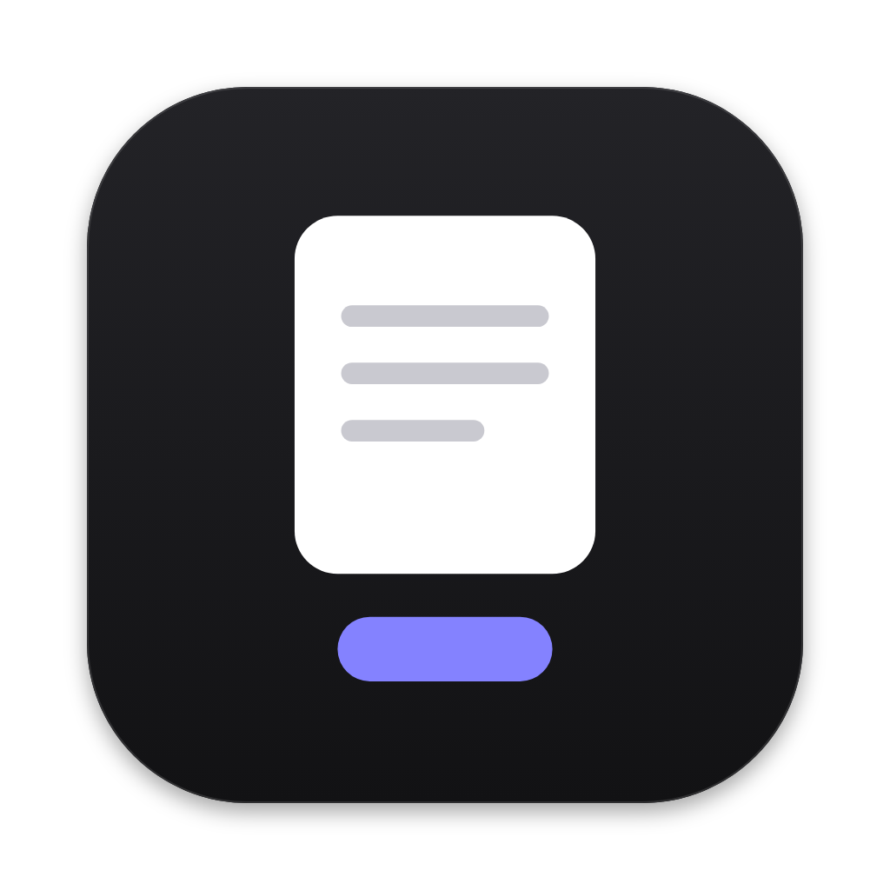
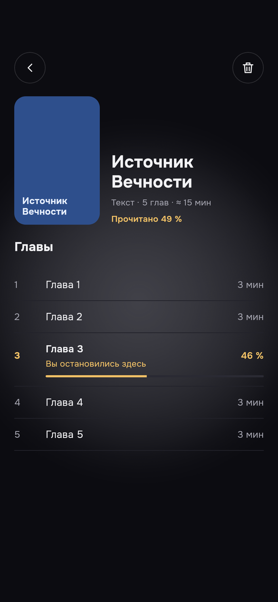
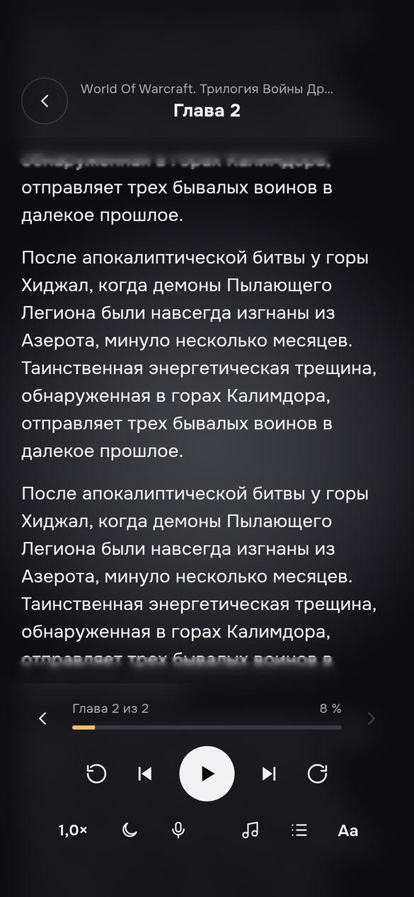
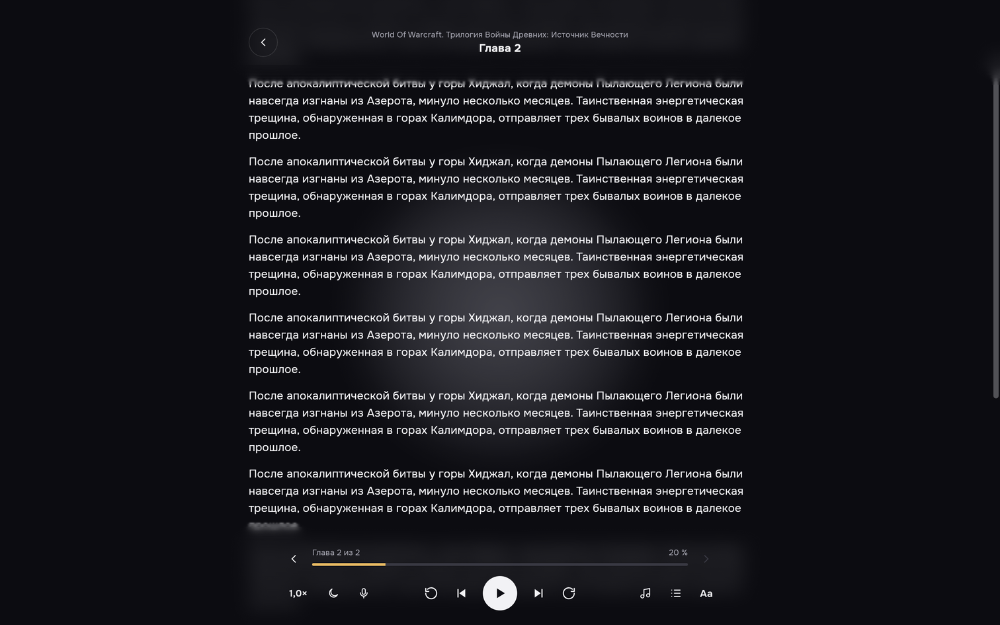

<p align="center">
  
</p>

<h1 align="center">Lumen</h1>

<p align="center">
  <b>Your books, read aloud by a calm neural voice.</b><br>
  An audiobook app that narrates EPUB, FB2, PDF and text books with Qwen3-TTS, for Mac, iPhone, Windows and Android.
</p>

<p align="center">
  
  
  
  
</p>

---

Lumen turns the text books you already have into audiobooks. Add an EPUB, FB2, PDF or plain text file, and one narrator reads the whole book with a neural voice (Qwen3-TTS from [lumen-voice-server](https://github.com/BradD06/lumen-voice-server)). There are no separate voices per character: the narrator tells them apart by intonation, the way a good reader does. Calm background music can play quietly under the voice. The text sits under the player with the spoken word lit in amber, and Lumen remembers where you stopped in every chapter.

<p align="center">
  
  &nbsp;
  
</p>

## Features

Lumen is being built stage by stage (see [Roadmap](#roadmap)). The full, checked list of what works today, with the code behind each line, is in [docs/FEATURES.md](docs/FEATURES.md) (in Russian).

### 📚 Books and library
- Add a book from a file: **EPUB, FB2 (also zipped), PDF with text and TXT**, or paste a story from the clipboard. On a computer, just drop the file into the window.
- Lumen splits the book into chapters (by the table of contents, FB2 sections, PDF bookmarks or "Chapter 1" headings), drops footnotes, page numbers and running headers, and joins lines back into paragraphs. Russian encodings (Windows-1251, KOI8-R) are read correctly.
- Illustrations from EPUB and FB2 stay in the text, in color, and open full screen.
- A library of covers with search by title or author; books without a cover get a colored one with their title.
- Each chapter reopens at the exact paragraph where you stopped. The chapter list marks where you are and what you have finished.

### 🎧 Narration
- One narrator for the whole book, characters distinguished by intonation only.
- The narration core is ready and tested: text is split into sentences (initials, abbreviations and dialogue dashes handled), the first sentence is voiced on its own so sound starts quickly, then parts grow to whole paragraphs. Phrases are cached on the device, the next three are prepared while one plays, a lost connection is retried for about a minute, and word timing is taken from the sound itself.
- When the server can't be reached, Lumen says plainly which it is: the server is not responding, or there is no internet. The server address and key live only in the system's secure storage.
- Player controls under the text: 15 s back and forward, previous / next phrase, speed 0.75–3×, sleep timer, voice, background music and chapters.
- In progress: sound in the player, the amber spoken-word highlight, background music under the voice, and listening offline to books voiced in advance.

### 🪟 Design «Графит»
- A dark graphite look with liquid glass on every platform: translucent, blurred panels over soft grey glows. Black, grey and white only, with amber for the spoken word and progress. Book covers and pictures stay in full color.
- A floating glass island at the bottom with five sections: Home, Catalog, Add, Library, Voices (⌘1…⌘5, Ctrl on Windows). The profile is a round glass button in the top-left corner.
- Opening a book grows its cover to fill the screen, then shows the chapters; opening a chapter blurs the screen and fades the text in.
- Details and mockups: [docs/DESIGN.md](docs/DESIGN.md) (in Russian).

<p align="center">
  
</p>

## Roadmap

The plan is in [docs/ROADMAP.md](docs/ROADMAP.md) (in Russian): thirteen stages, one [GitHub issue](https://github.com/BradD06/Lumen/issues) each, from the project foundation and the voice core through the player, background music and offline narration to AI analysis of who speaks each line and a fine-tuned voice of our own.

## Getting started

You need [Flutter](https://docs.flutter.dev/get-started/install) (the version CI uses is in [.github/workflows/ci.yml](.github/workflows/ci.yml)), plus Xcode for Mac and iPhone, Visual Studio with "Desktop development with C++" for Windows, or Android Studio for Android.

```sh
flutter pub get
flutter run -d macos   # or: -d windows, an iOS simulator, an Android device
flutter test
```

Step-by-step setup for each platform and fixes for common errors (in Russian): [docs/RUNNING.md](docs/RUNNING.md). On iPhone, judge smoothness with `flutter run --release`.

The voice comes from [lumen-voice-server](https://github.com/BradD06/lumen-voice-server) (Qwen3-TTS on a machine with an NVIDIA graphics card). The app works without it: books can still be added and read.

## Project structure

```
lib/                  screens: shell and island, library, book and chapter, add book, reader controls, theme
packages/
  lumen_core/         models and pure logic: Book, Chapter, Line (speaker + emotion), places in text
  lumen_import/       EPUB, FB2 and TXT parsers, PDF layout into chapters and paragraphs
  lumen_storage/      SQLite book store with append-only migrations
  lumen_voice/        narration core: sentences and paragraphs, voice server client, phrase cache and queue, word timing
  lumen_player/       playback: the voice and background music as two tracks
tool/make_icons.py    draws every app icon from one source
docs/                 FEATURES, ROADMAP, DESIGN, PORTING (what comes from Lumen_exemple), RUNNING
```

Dependencies only go downward (screens → player → voice → core, storage → core, import → core); `test/layers_test.dart` checks it. Every pull request runs formatting, analysis, tests and builds for all four platforms.

## Related

- [lumen-voice-server](https://github.com/BradD06/lumen-voice-server): the Qwen3-TTS voice server.
- [Lumen_exemple](https://github.com/BradD06/Lumen_exemple): the earlier Swift notes app, where the narration mechanics and the icon come from.

## Built with

Flutter · Dart · SQLite · PDFium (pdfrx) · Qwen3-TTS · Onest
