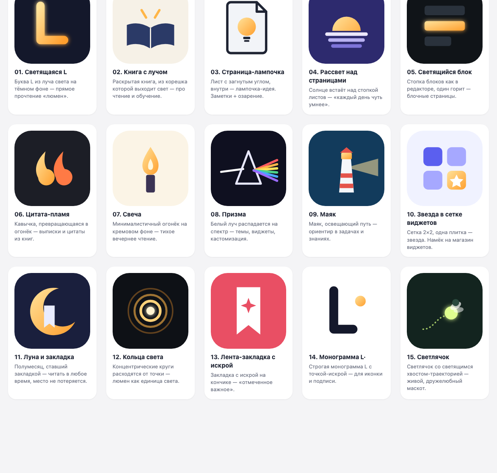

# Lumen — логотип и название

15 концептов иконки лежат в `logos/` (SVG, 512×512, форма иконки приложения).
`preview.html` — та же сетка в браузере. Перегенерировать: `python3 make_logos.py`.

Это наброски для выбора направления: после выбора 2–3 любимых их стоит
довести (сетка, оптические поправки, версии для тёмной темы и маленьких размеров).

## Созвучные названия

Проверено только на звучание, не на занятость: перед выбором нужно проверить
App Store, домены и товарные знаки.

| Название | Почему подходит |
|---|---|
| **Lumen** | Текущее: «единица света», коротко, звучит одинаково по-русски и по-английски |
| **Lumio** | Мягче и дружелюбнее, похоже на имя персонажа |
| **Lumina** | Звучнее и «премиальнее», женская форма |
| **Lumora** | Lumen + aurora: свет + рассвет, хорошо ложится на вариант 04 |
| **Lumenote** | Lumen + note: сразу понятно, что это заметки |
| **Lume** | Совсем коротко (итал. «свет»), удобно для иконки и домена |
| **Lucent** | «Светящийся, ясный»: про ясность мысли |
| **Lucid** | «Ясный»: акцент на понятной структуре знаний |
| **Glim** | «Проблеск»: игриво, хорошо сочетается со светлячком (15) |
| **Glowpage** | Прямо описывает идею: светящиеся страницы |
| **Lantern** | «Фонарь»: тёплый образ вечернего чтения |
| **Lux** | Тоже единица света, очень коротко (слово популярное, будет сложно с доменом) |
| **Illumi** | От illuminate: «озарять, просвещать», про обучение |
| **Firefly** | «Светлячок»: маскот и название сразу (слово очень занято) |
| **Свет / Svet** | Русская версия, если нужен локальный бренд |
